# FA Minigames


**A free, standalone collection of 13 interactive minigames for FiveM.**

Easily integrate customizable minigames into your server with simple client-side exports. From lockpicking and drilling to network hacking and safecracking, FA Minigames provides ready-to-use gameplay interactions without requiring a specific framework.

## Features

- **13 unique minigames** with different gameplay mechanics
- **Framework-independent**, compatible with ESX, QBCore, Qbox, and standalone servers
- **3 difficulty presets** (Easy, Medium, Hard) with per-option overrides
- **Theme customization**, including global and per-call colors
- **Multi-language support**, including English and Polish
- **Compact mode** for supported minigames
- **Simple Lua exports** with structured results
- **Built-in debug command** for testing minigames in-game

## Requirements

No framework, inventory, or database dependencies are required. `ox_lib` is only used in the Keypad validation example and can be replaced with any server callback system.

## Table of contents

- [Available games](#available-games)
- [Preview](#preview)
- [Installation](#installation)
- [Basic usage](#basic-usage)
- [Difficulty presets](#difficulty-presets)
- [Complete options reference](#complete-options-reference)
- [Theme configuration](#theme-configuration)
- [Locales](#locales)
- [Compact presentation](#compact-presentation)
- [Result contracts](#result-contracts)
- [Security boundary](#security-boundary)
- [Troubleshooting](#troubleshooting)
- [Debugging](#debugging)
- [Development](#development)
- [Contributing](#contributing)
- [License](#license)

## Available games

| Export | Player objective |
| --- | --- |
| `Drill` | Balance pressure, drill speed, and heat to clear four pins. |
| `Keypad` | Enter and optionally validate a four-digit code. |
| `Skillbar` | Stop a moving marker inside the target area. |
| `Sequence` | Repeat the displayed button sequence. |
| `Lockpick` | Find the lock's binding angle and apply tension. |
| `Pattern` | Memorize and recreate a highlighted grid pattern. |
| `Wires` | Drag leads between matching labeled channels. |
| `Circuit` | Rotate tiles into one connected route. |
| `Fingerprint` | Align horizontal fingerprint slices. |
| `Terminal` | Find requested terminal tokens across multiple traces. |
| `NetworkHack` | Memorize a safe route, then navigate adjacent network nodes. |
| `Safecracker` | Find dial binding positions while alternating turn direction. |
| `FrequencyTuning` | Match reference frequency and phase, then hold the signal steady. |

## Preview

| | | |
| --- | --- | --- |
| **Drill**<br>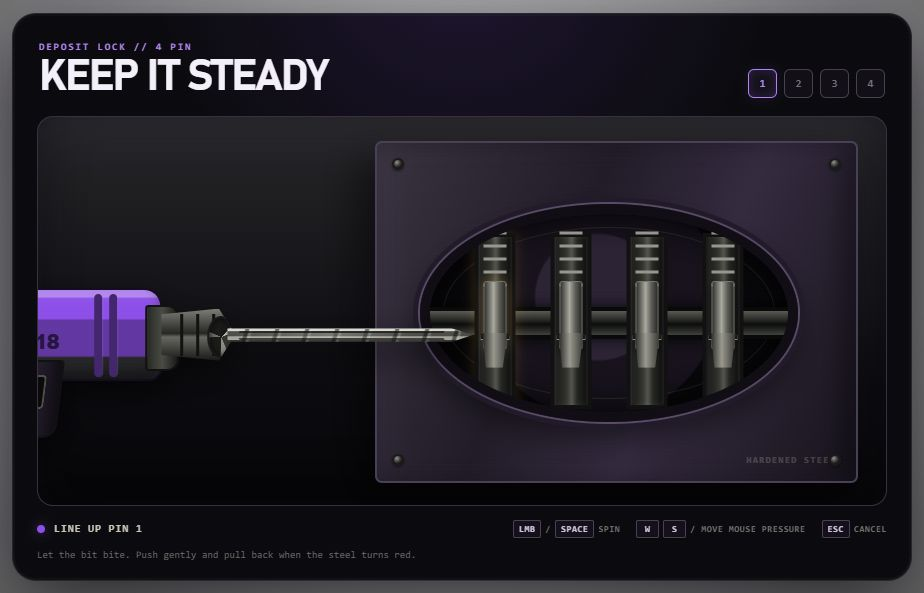 | **Keypad**<br>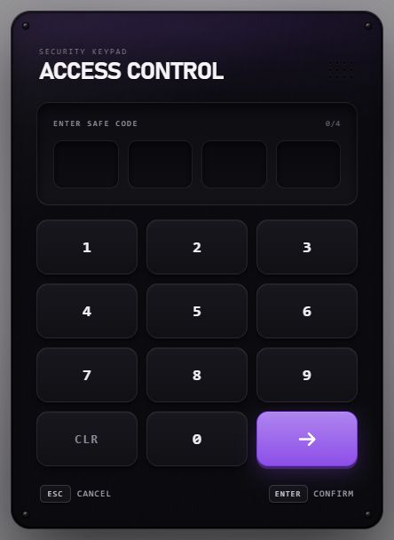 | **Skillbar**<br>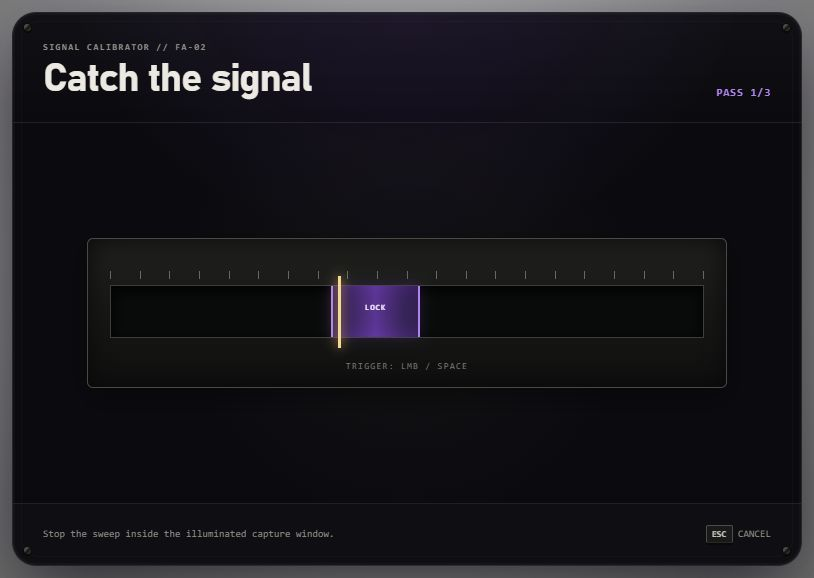 |
| **Sequence**<br>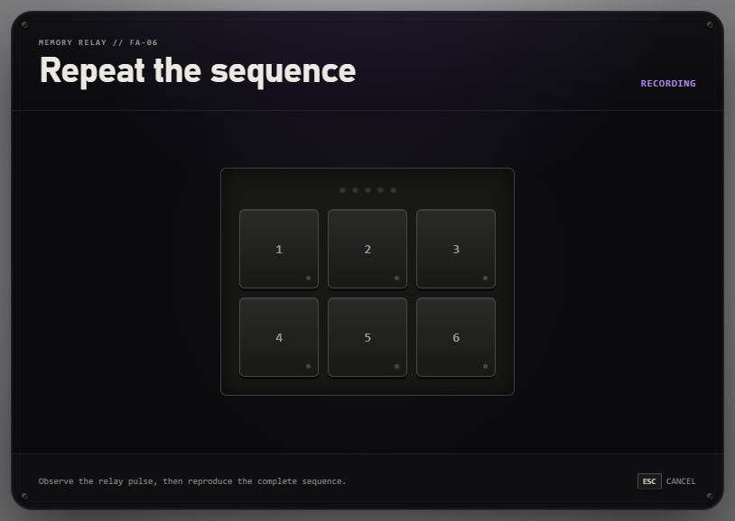 | **Lockpick**<br>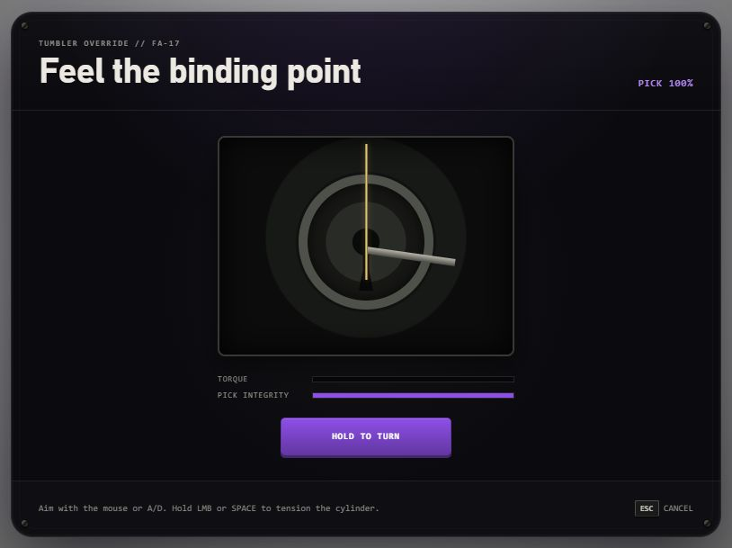 | **Pattern**<br>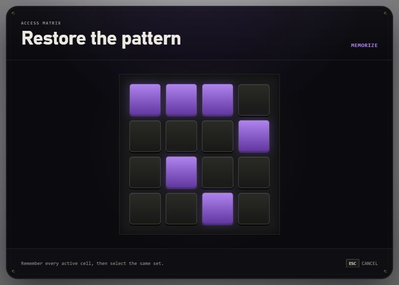 |
| **Wires**<br>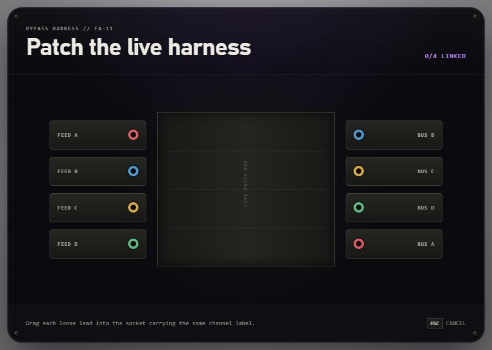 | **Circuit**<br>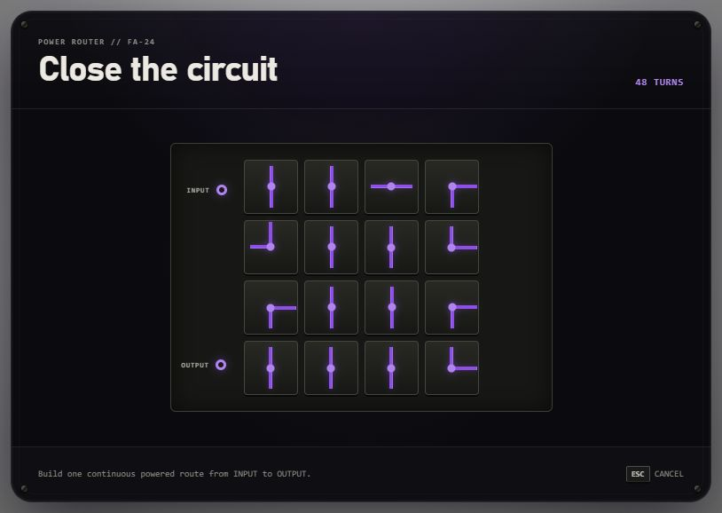 | **Fingerprint**<br>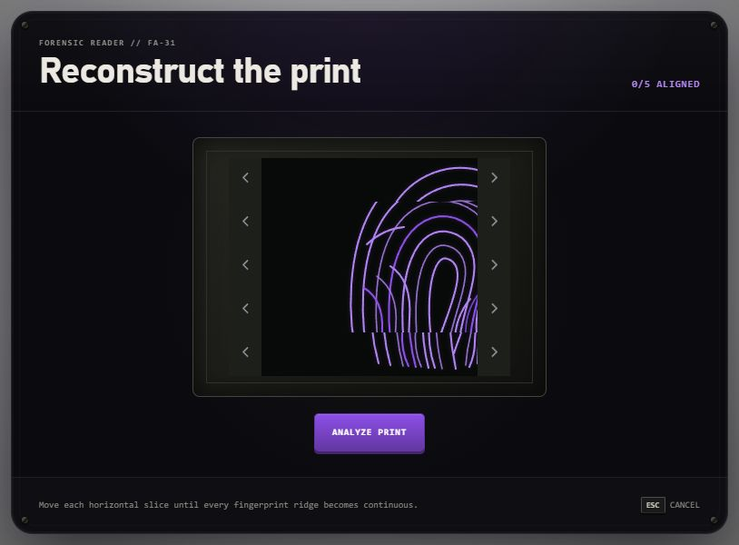 |
| **Terminal**<br>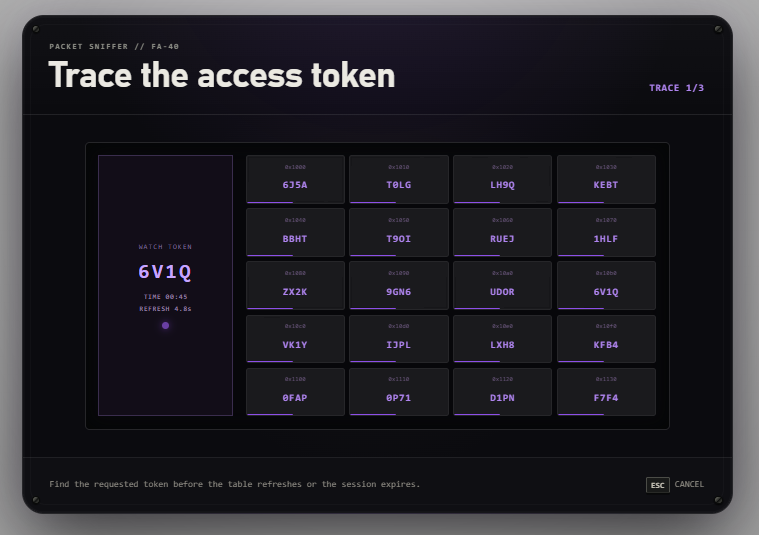 | **FrequencyTuning**<br>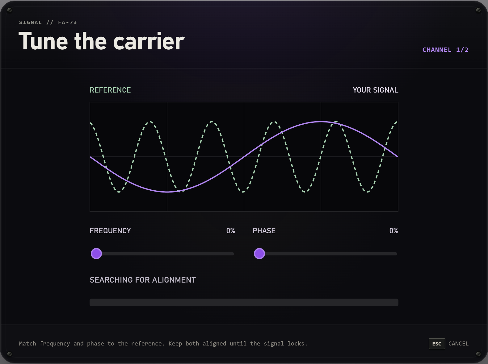 | **Safecracker**<br>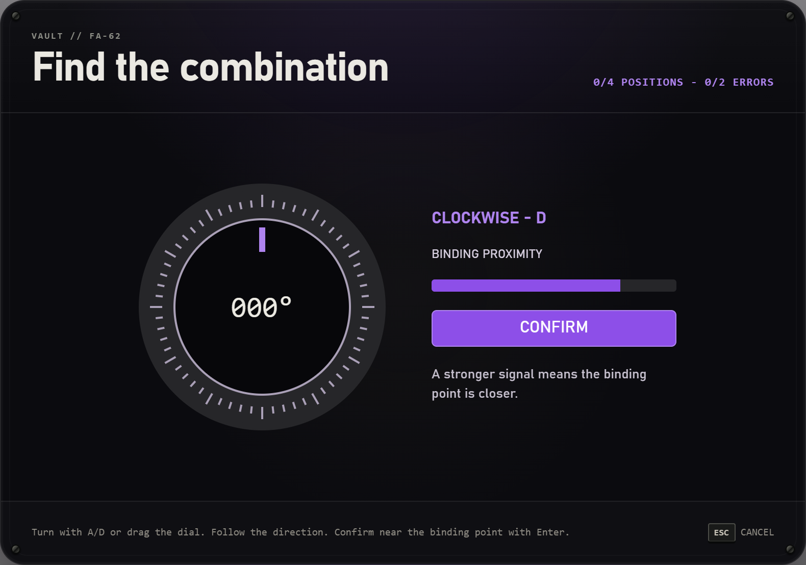 |
| **NetworkHack**<br>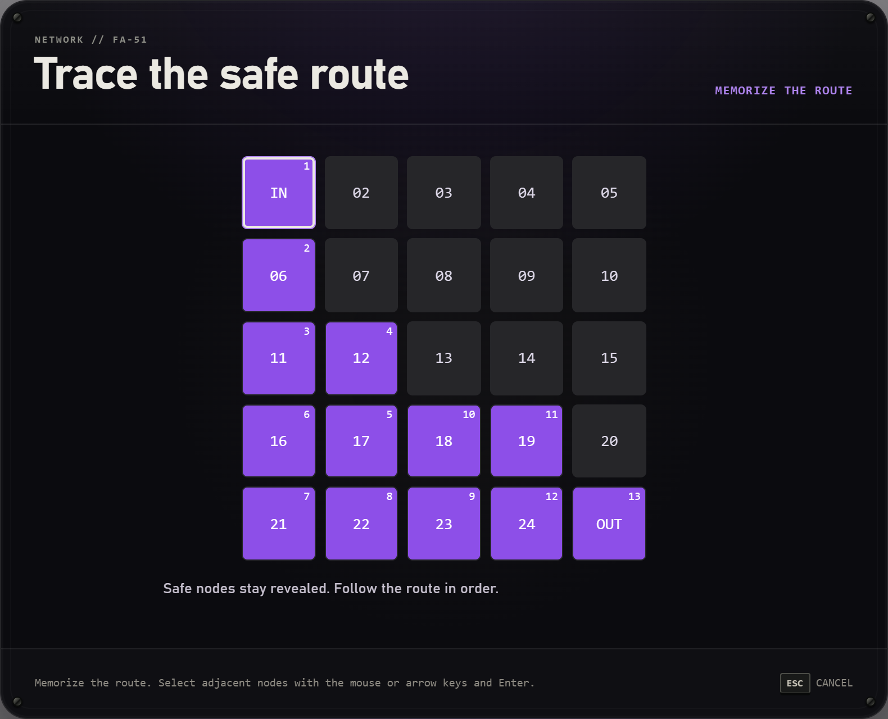 | | |

## Installation

1. [Download a release](https://github.com/FA-Scripts/fa_minigames/releases/latest) or clone this repository into your server's resources directory.
2. Keep the folder name `fa_minigames`, or update every export call if you rename it.
3. Start `fa_minigames` before resources that use its exports.

```cfg
ensure fa_minigames
ensure your_resource
```

The release must include `web/dist/index.html` and `web/dist/assets`. Releases already include them. If you clone the repository instead, build the NUI first (see [Web development](#web-development)), otherwise you will get an "NUI missing" error.

Restart the server and verify one export in-game before integrating rewards or progression.

## Basic usage

Exports wait for the player to finish and return a result table to the calling client coroutine.

**client.lua**

```lua
local result = exports.fa_minigames:Skillbar({
    difficulty = 3,
    rounds = 4,
    timeout = 30000
})

if result.success then
    -- Ask your server to validate and complete the owning action.
    TriggerServerEvent('my_resource:skillbarDone')
else
    print(('Minigame stopped: %s'):format(result.reason))
end
```

**server.lua**

```lua
RegisterNetEvent('my_resource:skillbarDone', function()
    local src = source
    -- Do NOT trust this event alone. Check here:
    -- distance to target, cooldown, required item, current state.
    -- Only then grant the reward.
end)
```

A client event can be forged, so the server must always verify the conditions independently. See [Security boundary](#security-boundary).

Only one session can run at a time. A concurrent call returns `reason = 'busy'`. Cancel the current session with `exports.fa_minigames:Cancel()`. The player can also cancel with Escape, including while a keypad validator is waiting.

## Difficulty presets

Every game accepts `'easy'`, `'medium'`, or `'hard'`. Calling an export without arguments uses `medium`.

```lua
local result = exports.fa_minigames:Circuit('easy')
```

An options table can select a preset and override individual values:

```lua
local result = exports.fa_minigames:Terminal({
    difficulty = 'hard',
    refreshInterval = 10000,
    timeLimit = 60000
})
```

In the table below, "difficulty N" refers to the numeric `difficulty` option.

| Game | Easy | Medium | Hard |
| --- | --- | --- | --- |
| Drill | difficulty 1 | difficulty 2 | difficulty 4 |
| Keypad | 45 s timeout | 30 s timeout | 20 s timeout |
| Skillbar | difficulty 1, 2 rounds | difficulty 3, 3 rounds | difficulty 5, 4 rounds |
| Sequence | 3 inputs, slower preview | 5 inputs | 7 inputs, faster preview |
| Lockpick | difficulty 1 | difficulty 3 | difficulty 5 |
| Pattern | 4 cells, 2.5 s preview | 6 cells, 1.8 s preview | 8 cells, 1.3 s preview |
| Wires | 3 channels | 4 channels | 5 channels |
| Circuit | 3 × 3 | 4 × 4 | 5 × 5 |
| Fingerprint | 3 slices | 5 slices | 7 slices |
| Terminal | 12 entries, 2 traces | 20 entries, 3 traces | 28 entries, 4 traces |
| NetworkHack | 4 × 4, 3 s preview, 2 errors | 5 × 5, 2.2 s preview, 1 error | 6 × 6, 1.5 s preview, no errors |
| Safecracker | 3 positions, ±10°, 3 errors | 4 positions, ±7°, 2 errors | 5 positions, ±4°, 1 error |
| FrequencyTuning | 1 round, 8% tolerance, 1 s hold | 2 rounds, 5% tolerance, 1.5 s hold | 3 rounds, 3% tolerance, 2 s hold |

## Complete options reference

All time values are in milliseconds. Numeric values are clamped to the ranges below, and non-numeric values fall back to the selected preset. The outer `timeout` has a minimum of 5000 ms. `NetworkHack`, `Safecracker`, and `FrequencyTuning` also cap it at 600000 ms.

Common options accepted by every options table:

| Option | Type | Default | Description |
| --- | --- | --- | --- |
| `difficulty` | preset string or supported number | `medium` | Selects a preset; numeric difficulty is supported by Drill, Skillbar, and Lockpick. |
| `timeout` | number | preset-specific | Maximum lifetime of the complete session. |
| `locale` | string | `Config.Locale` | Selects a table from `Locales`. |
| `theme` | table | `Config.Theme` | Per-call `main` and `accent` overrides. |

Game-specific options and safe ranges:

| Export | Options |
| --- | --- |
| `Drill` | `difficulty` 1–5, `timeout` |
| `Keypad` | `title` up to 32 characters, `timeout`, client-only `validate(code)` |
| `Skillbar` | `difficulty` 1–5, `rounds` 1–8, `timeout`, `compact` |
| `Sequence` | `length` 3–9, `previewInterval` 220–900, `timeout`, `compact` |
| `Lockpick` | `difficulty` 1–5, `timeout`, `compact` |
| `Pattern` | `length` 3–9, `previewDuration` 800–5000, `timeout`, `compact` |
| `Wires` | `channels` 3–5, `timeout` |
| `Circuit` | `size` 3–5, `timeout` |
| `Fingerprint` | `slices` 3–7, `timeout` |
| `Terminal` | `entries` 12–30, `rounds` 1–6, `refreshInterval` 1000–60000, `timeLimit` 5000–300000, `timeout` |
| `NetworkHack` | `size` 4–6, `previewDuration` 500–10000 ms, `maxErrors` 0–10 |
| `Safecracker` | `positions` 1–8, `tolerance` 2–20 degrees, `maxErrors` 0–10 |
| `FrequencyTuning` | `rounds` 1–8, `tolerance` 1–15 percent of each 0–100 slider, `holdDuration` 250–10000 ms |

Default outer `timeout` per preset:

| Export | Easy | Medium | Hard |
| --- | --- | --- | --- |
| `Keypad` | 45 s | 30 s | 20 s |
| `NetworkHack` | 45 s | 40 s | 35 s |
| `Safecracker` | 60 s | 55 s | 50 s |
| `FrequencyTuning` | 40 s | 45 s | 50 s |

Example calls:

```lua
local network = exports.fa_minigames:NetworkHack({
    difficulty = 'hard',
    previewDuration = 2500,
    locale = 'pl'
})
local safe = exports.fa_minigames:Safecracker('medium')
local signal = exports.fa_minigames:FrequencyTuning({
    difficulty = 'easy',
    rounds = 2,
    holdDuration = 1500,
    timeout = 60000
})
```

### Error handling (`maxErrors`)

Applies to `NetworkHack` and `Safecracker`. `maxErrors` is the number of mistakes allowed; the next mistake fails the game. `maxErrors = 0` means no mistakes are tolerated.

### NetworkHack

- **Controls:** mouse, or arrow keys + Enter.
- **Rules:** memorize the numbered route (it includes the start node), then select nodes in order.
- **Mistakes:** selecting an adjacent node that is not the next route node counts as an error. Non-adjacent and already completed nodes are ignored.

### Safecracker

- **Controls:** A/D, drag the dial, or arrow keys on the focused dial. Enter or the confirm button submits a position.
- **Rules:** you can only turn in the indicated direction. Each confirmation also checks the approach direction.
- **Mistakes:** turning the wrong way counts as one error per excursion. Holding the wrong key does not use up more attempts. Turning correctly re-arms the penalty.
- **Failed confirmation:** completed positions are kept.

### FrequencyTuning

- **Controls:** sliders with mouse, arrow keys, Home, and End.
- **Rules:** keep both sliders within tolerance continuously for `holdDuration`.
- **Reset:** leaving tolerance (or suspending the browser) restarts the hold.

### Terminal

- **Defaults:** 10 s table refresh, 60 s internal time limit, 61 s outer timeout.
- **Note:** when overriding both, keep `timeout` slightly longer than `timeLimit`, otherwise the game closes immediately when the outer timeout expires.

## Theme configuration

Set global colors in `config.lua`. Values use the `#RRGGBB` format.

```lua
Config.Theme = {
    main = '#0B0B0F',
    accent = '#8D4FE8'
}
```

`main` controls the primary dark surfaces. `accent` controls actions, active states, highlights, traces, and scan graphics. The NUI derives additional shades and selects readable text for light or dark accents.

Override either color for one call without rebuilding the NUI:

```lua
local result = exports.fa_minigames:Skillbar({
    difficulty = 'medium',
    theme = {
        main = '#101820',
        accent = '#00B8D9'
    }
})
```

Invalid colors fall back to the configured defaults. The visual system is designed around a dark `main` surface.

## Locales

English (`en`) and Polish (`pl`) are included. Set the default locale in `config.lua` with `Config.Locale = 'en'`. Locale files live in the `locales` folder. To add a language, copy `locales/en.lua`, change the table key, translate every value, and select it globally or per call.

```lua
Locales.de = {
    cancel = 'ABBRECHEN',
    confirm = 'BESTÄTIGEN',
    -- Copy and translate the remaining keys from locales/en.lua.
}

local result = exports.fa_minigames:Lockpick({ locale = 'de' })
```

Placeholders such as `{round}`, `{rounds}`, `{pin}`, and `{durability}` must remain in translated strings. Missing entries use the English fallback embedded in the NUI.

## Compact presentation

`Skillbar`, `Sequence`, `Lockpick`, and `Pattern` accept `compact = true`. Compact mode hides the surrounding frame and secondary information; the game controls keep their normal size.

```lua
local result = exports.fa_minigames:Lockpick({
    difficulty = 'hard',
    compact = true,
    timeout = 25000
})
```

## Result contracts

`Skillbar`, `Sequence`, `Lockpick`, `Pattern`, `Wires`, `Circuit`, `Fingerprint`, `Terminal`, `NetworkHack`, `Safecracker`, and `FrequencyTuning` return:

```lua
{
    success = boolean,
    reason = 'completed' | 'failed' | 'cancelled' | 'timeout' | 'busy',
    data = table | nil
}
```

`NetworkHack`, `Safecracker`, and `FrequencyTuning` also include `data.completedStages` and `data.elapsedMs`. `NetworkHack` and `Safecracker` additionally include `data.errors`. Cancellation, timeout, and `busy` may return no `data`.

> ⚠️ `data` contains diagnostic details such as completed rounds, remaining durability, aligned slices, or selected cells. It is **not** authoritative server state. Never use it to grant rewards.

### Drill

`Drill` returns `success` and `reason` using the same `reason` values as above.

```lua
local result = exports.fa_minigames:Drill('medium')

if result.success then
    -- Ask your server to validate and complete the owning action.
end
```

### Keypad

Without a validator, `Keypad` returns the submitted code plus `submitted`, `success`, `validated`, `reason`, and optional `message` fields.

```lua
local result = exports.fa_minigames:Keypad({
    title = 'Safe',
    timeout = 30000
})

if result.submitted then print(result.code) end
```

Never send the correct code to the NUI. Validate it through the server owned by your consuming resource:

```lua
local result = exports.fa_minigames:Keypad({
    title = 'Safe',
    timeout = 30000,
    validate = function(code)
        -- This example uses ox_lib's callback. Replace it with any server callback you prefer.
        local response = lib.callback.await('my_resource:validateCode', false, code)

        return {
            success = response.success == true,
            close = response.success == true,
            reason = response.success and 'completed' or 'failed',
            message = response.message
        }
    end
})
```

Returning `close = false` clears an invalid entry and keeps the keypad open.

## Security boundary

A successful client minigame is player input, not authority to grant rewards or complete protected state. The consuming server must validate:

- player permissions and role,
- distance and target identity,
- current gameplay state,
- attempts, cooldowns, and rate limits,
- required items and inventory capacity,
- rewards and every persistent change.

Keep correct keypad codes, reward values, webhooks, and secrets server-side.

## Troubleshooting

- **Export missing:** start `fa_minigames` before its consumer and use exact export casing.
- **NUI missing:** confirm `web/dist/index.html` and the built assets are present, then inspect the first client-console error.
- **`busy` result:** wait for the active session or call `Cancel()` before starting a replacement.
- **Immediate close:** verify that `timeout` is in milliseconds; Terminal's outer timeout should exceed `timeLimit`.
- **Insecure reward:** move the owning decision to the server; a client success must not grant money, items, access, or progression.

Bug reports should include the version, FiveM artifact, game build, resource order, exact export call, reproduction steps, and the first relevant error. Remove secrets from logs.

## Debugging

Set `Config.Debug = true` in `config.lua`, restart the resource, then use:

```text
/faminigame <game> [easy|medium|hard] [compact]
```

Examples:

```text
/faminigame drill medium
/faminigame skillbar easy compact
/faminigame lockpick hard compact
```

The command is only registered while debug mode is enabled. Its start and result messages appear in the F8 console and, when the standard `chat` resource is running, in chat. Keep `Config.Debug = false` on production servers.

Valid game names are `drill`, `keypad`, `skillbar`, `sequence`, `lockpick`, `pattern`, `wires`, `circuit`, `fingerprint`, `terminal`, `networkhack`, `safecracker`, and `frequencytuning`. Compact mode is intended for `skillbar`, `sequence`, `lockpick`, and `pattern`.

## Development

This section is for contributors who want to modify the NUI.

### Web development

```powershell
cd web
npm.cmd install
npm.cmd run dev
npm.cmd test
npm.cmd run typecheck
npm.cmd run build
```

Use query parameters to open browser mocks:

```text
?game=terminal
?game=networkhack&preset=hard&locale=pl
?game=lockpick&compact=true
?game=keypad&main=101820&accent=00B8D9
```

The preview toolbar selects the game, preset, and language; restarts create a fresh session, and results remain visible after completion. Browser presets and translations are generated from Lua by `scripts/sync-preview.mjs` before dev, tests, typecheck, and build. Restart dev after editing Lua locale or preset files.

The browser keypad accepts `1234` as its preview success code.

Browser mocks and static builds do not prove NUI focus, FiveM callbacks, resource-stop cleanup, or live gameplay. Test changed interactions in FiveM before publishing a release.

## Contributing

See [CONTRIBUTING.md](CONTRIBUTING.md). Keep contributions focused, framework-independent, and compatible with the shared session/result contract.

## License

[MIT](LICENSE)
